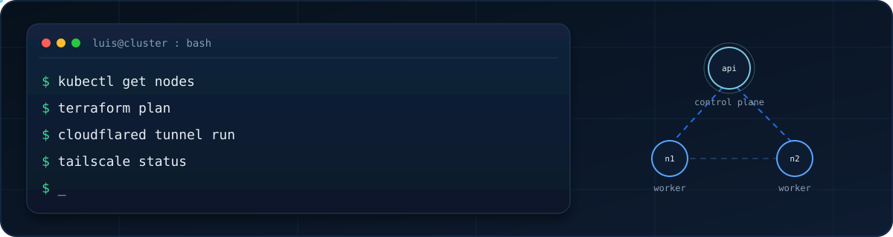

# Luis Fredy Huachaca Vargas

**Cloud / DevOps & Security Engineer · Co-founder & CTO @ [Moontecx](https://www.moontecx.com/)**

Arequipa, Perú · vers la France · ES / FR / EN

## About

Computer scientist in Arequipa, Peru (Ciencia de la Computación, Universidad Católica San Pablo, 2020–2025). Co-founder and CTO at [Moontecx](https://www.moontecx.com/) since October 2026: technology strategy, product, and cloud infrastructure for the startup.

Previously a junior software engineer and data analyst at Newroad Global Investing (December 2025–October 2026), on the stock-market / wealth-management side. Work there included data analysis and ETL, and the production setup for **Wealth Navigator**: a VPS, Tailscale, Cloudflare Tunnel, and blue/green deploys. Also took part in a networking event on investing with Inviu in Arequipa.

Research stay and exchange at ESTIA Institute of Technology (Bidart, France), 2023–2025, on-site in France for the whole period. The work was green computing: comparative energy use of microservice architectures on AWS EC2, measured with PowerAPI and Scaphandre, in a stack of Kubernetes, Helm, Terraform, CI/CD, Docker, Grafana, and Linux.

Co-created **SAM (Savings Asset Manager)** with Manuel Cáceres — a budgeting and investing app for developers, through brokers such as Wallbit and IBKR. There is no public repository for SAM yet. He also builds on Cloudflare Workers (free tier); [iglepicha](https://github.com/Luis-Huachaca-HV/iglepicha) is the public example.

## Stack

**Cloud & DevOps**

**Security**

Computer security was part of the degree. Cybersecurity is what he is studying now.

**Backend**

**Data**

**Frontend**

**Domains** — fintech and trading, wealth-management platforms, microservices, green computing.

## Selected work

### [Research-Project-Energy-Consumption](https://github.com/Luis-Huachaca-HV/Research-Project-Energy-Consumption)

Artifact for **LLAPA**, a workflow that attributes microservice energy to CPU, RAM, NIC, and storage. The repo packages TeaStore and µBench benchmark notes, EcoFloc probes, Scaphandre for comparison, and the EnergyScore scheduler plugin.

### [scheduler-luis](https://github.com/Luis-Huachaca-HV/scheduler-luis)

**EnergyScore**, an energy-aware score plugin on the Kubernetes scheduler framework (Go). The repository builds on upstream [kubernetes-sigs/scheduler-plugins](https://github.com/kubernetes-sigs/scheduler-plugins); the energy plugin, scheduler profile, and install notes are the work published here. The repo’s install notes target a second scheduler on Kubernetes 1.28+.

### [llmwhatsappfinance](https://github.com/Luis-Huachaca-HV/llmwhatsappfinance)

**Finanzas WA** — multi-user finance over WhatsApp (Kapso) plus a React dashboard. A TypeScript API (Hono) on Google Cloud Run turns messages into ledger actions with an LLM (OpenRouter) and stores them in Supabase: expenses, income, debts, monthly summaries.

### [2024-34-3](https://github.com/Luis-Huachaca-HV/2024-34-3)

Real-time and batch analytics: Kafka, a Node backend, a React dashboard, and Python jobs (`kafka-python`, PySpark).

### [iglepicha](https://github.com/Luis-Huachaca-HV/iglepicha)

Next.js app for football pickup games (auth, live match dashboard, draft, attendance, payments) on Supabase. Deploy config in the repo is Cloudflare Workers via OpenNext and Wrangler.

**SAM (Savings Asset Manager)** — budgeting and investing for developers, co-created with Manuel Cáceres (Wallbit, IBKR). No public repository.

**Techsuyo 2023** — finalist, AI hackathon organized by Google Developer Group and Silicon Valley tech group.

Earlier C/C++ coursework is still on the account. [RubickAnimations](https://github.com/Luis-Huachaca-HV/RubickAnimations) is an old Rubik’s-cube animation project; it is not the focus of this profile.

## Experience

**Co-founder & CTO · [Moontecx](https://www.moontecx.com/)**  
October 2026 — present · Arequipa, Peru

Technology startup. Technology strategy, product, and cloud infrastructure.

**Junior software engineer & data analyst · Newroad Global Investing**  
December 2025 — October 2026 · Peru

Integration of the company’s technology, data analysis, and ETL for the client experience. Production infrastructure for the Wealth Navigator wealth-management platform: VPS, Cloudflare Tunnel, Tailscale, blue/green deploys. Took part in organizing a networking event on investing with Inviu in Arequipa.

**Research, cloud systems & full stack · ESTIA Institute of Technology**  
2023 — 2025 · on-site, Bidart, France

The whole stay was on-site in France, including the computer-engineering exchange. Green-computing research: energy of microservice architectures on AWS EC2 with PowerAPI and Scaphandre. Environment: Kubernetes, Helm, Terraform, CI/CD, Docker, Grafana, Linux.

**GIPE 2023 · DAAD / UNDP Accelerator Labs**  
January 2023 — December 2023

International project with the Westfälische Hochschule (Germany) and universities in Namibia and Indonesia. Results presented to the vice-rector of UCSP.

**Internship · Arboriza21**  
April 2023 — July 2023 · Arequipa, Peru

Donation website for a reforestation NGO.

## Education

**Computer Science (Ciencia de la Computación)** · Universidad Católica San Pablo, Arequipa  
2020 — 2025

Relevant coursework: Cloud Computing, Computer Security, Big Data, Databases, Artificial Intelligence, Software Engineering, Statistics and Probability, Numerical Analysis, technology-venture formation, and leadership.

**Exchange · Computer Engineering** · ESTIA Institute of Technology, Bidart, France  
On-site in France, part of the 2023–2025 research stay above.

**Languages** — Spanish (native) · French B2 (DELF B2 session, November 2026) · English, working proficiency · German, basic.

Interests: stock-market investing, green tech, football, hiking.

## Now

Currently learning cybersecurity, building on the computer-security course from the degree.

## GitHub

Public activity only. The language card leaves out `scheduler-luis`, `ecofloc-microservices`, and the DeathStarBench fork, because those trees are mostly upstream code. If a card does not load, the [profile](https://github.com/Luis-Huachaca-HV) still does.

 

### Contribution snake

Generated by [`.github/workflows/snake.yml`](.github/workflows/snake.yml) onto the `output` branch (schedule, manual run, and pushes to `main`). The README points at the last SVGs that landed there; a failed run does not remove them.

<picture>
  <source media="(prefers-color-scheme: dark)" srcset="https://raw.githubusercontent.com/Luis-Huachaca-HV/Luis-Huachaca-HV/output/github-contribution-grid-snake-dark.svg" />
  <source media="(prefers-color-scheme: light)" srcset="https://raw.githubusercontent.com/Luis-Huachaca-HV/Luis-Huachaca-HV/output/github-contribution-grid-snake.svg" />
  
</picture>

## Contact

[GitHub](https://github.com/Luis-Huachaca-HV) · [LinkedIn](https://www.linkedin.com/in/luis-huachaca-vargas-5a893120a) · [Moontecx](https://www.moontecx.com/) · [CV, EN / ES](https://luis-huachaca-hv.github.io/Resume/)

*D'Arequipa vers la France — cloud, fintech, and the systems underneath.*

